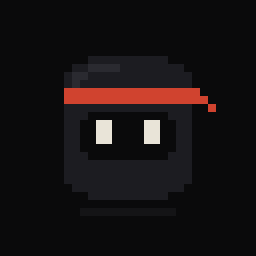
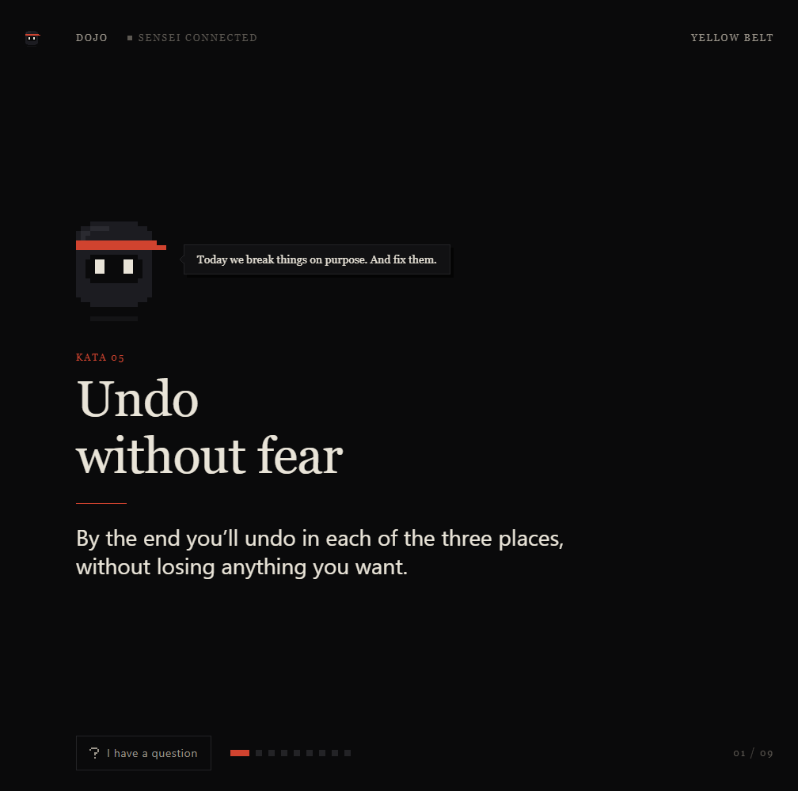
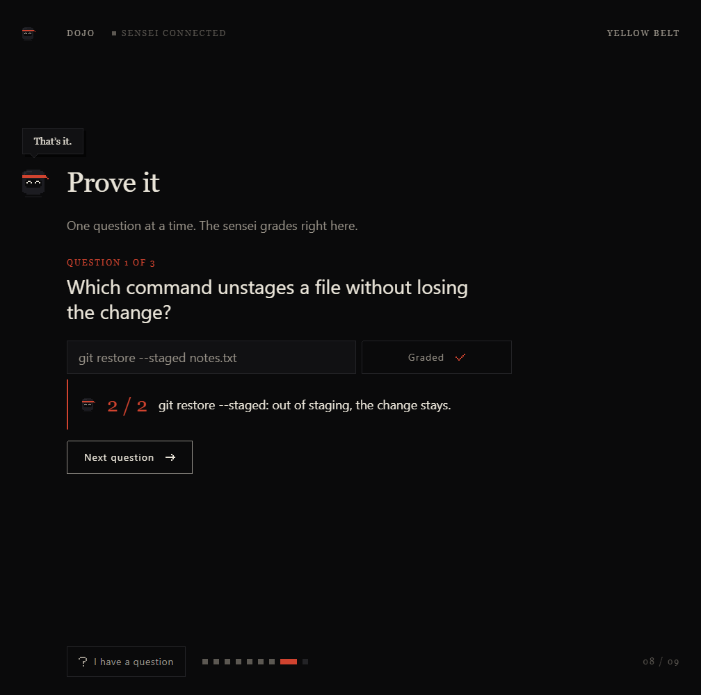
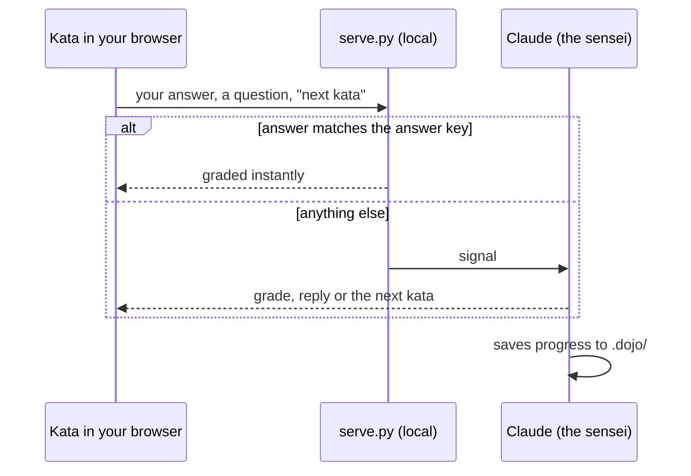
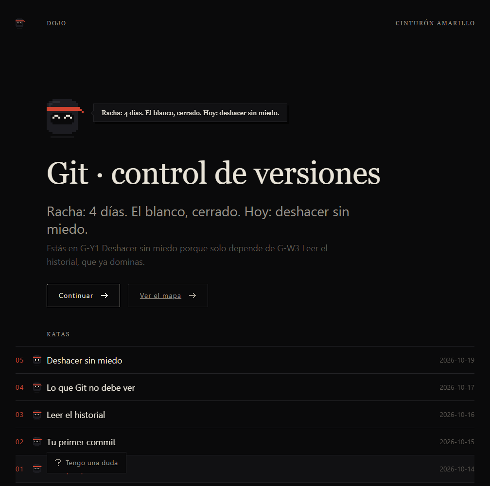
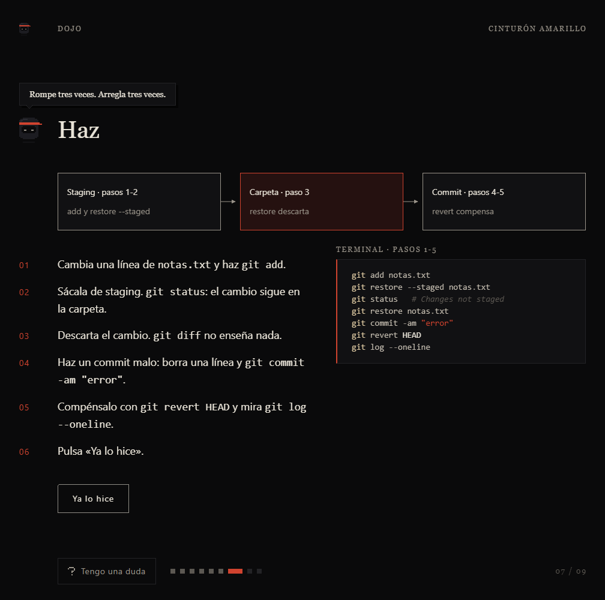
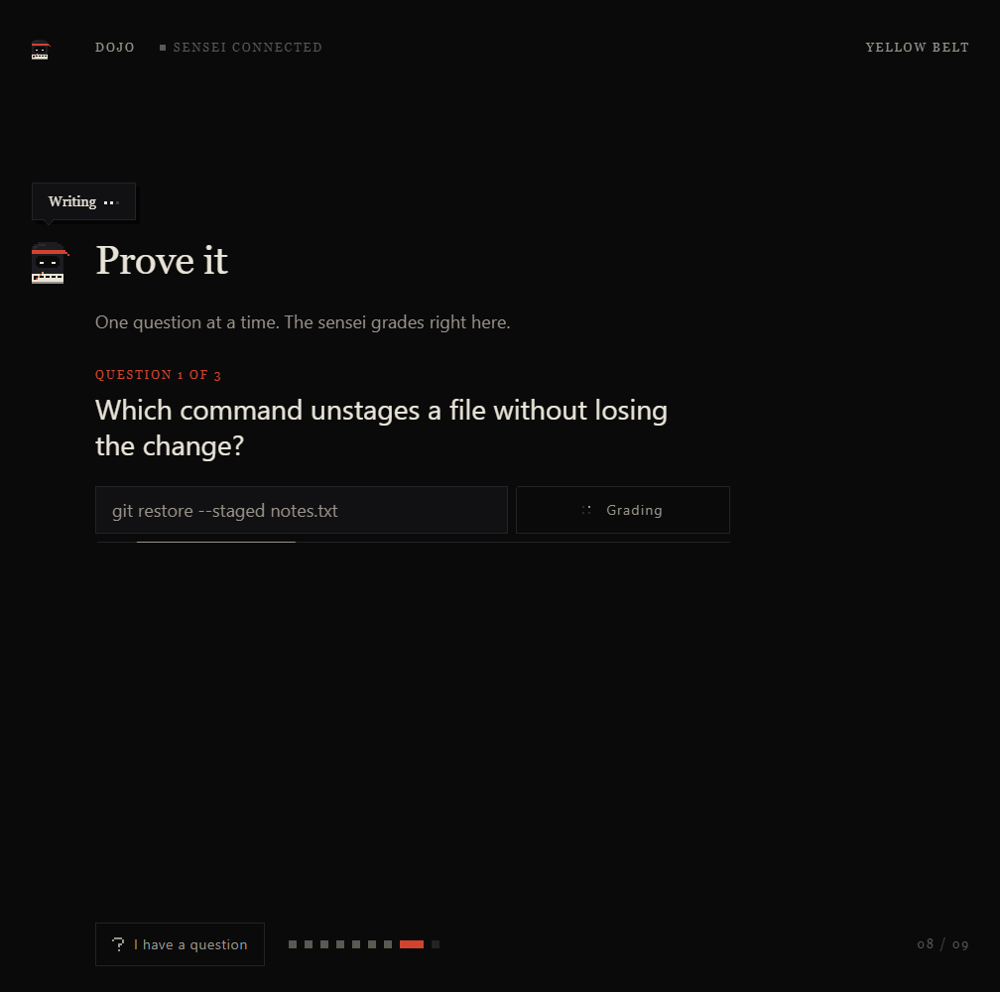
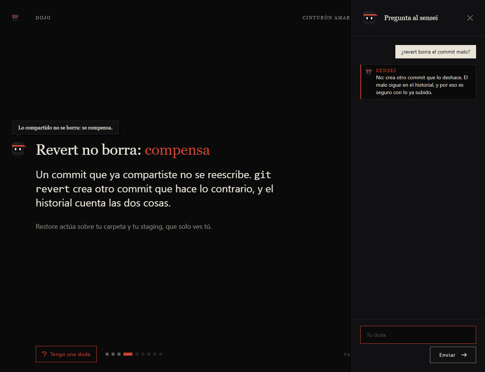
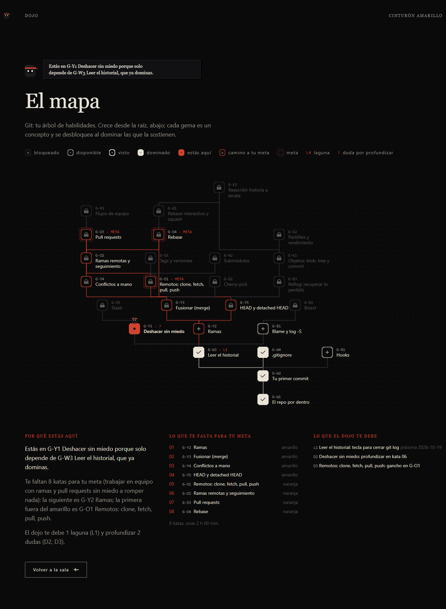

<div align="center">



# Sensei Dojo

**A persistent tutor for Claude Code. You learn; the AI doesn't do the work for you.**

Short katas, quizzes with one right answer, real tasks in your own tools,<br>
and a progress map that remembers where you left off. Works for any technical domain.

[](#install)
[](skills/dojo/scripts)
[](LICENSE)

[Install](#install) · [Usage](#usage) · [How a kata works](#how-a-kata-works) · [Screenshots](#screenshots) · [Try the demo](#try-the-demo)

</div>

---

<p align="center">
  
  
</p>

## What it is

Type `/dojo` in any project folder. The sensei looks at what's there (or asks what you want to learn), runs a short diagnostic, and **builds a curriculum for that domain**: seven belts, white to black, each concept with its prerequisites, a hands-on task and quiz questions.

From then on, every `/dojo` is one kata: a single concept, a slide deck that opens in your browser, a task you do yourself in the real tool, and three questions graded on the page. Everything is saved as plain Markdown in `.dojo/`, so you can pick up weeks later exactly where you stopped.

> **Dojo rule:** the sensei never writes your code. Dictate and it types; ask it to "just do it" and you get a hint instead.

Git, SQL, Python, JavaScript, Blender, a game engine: any domain works.

## Features

| Feature | What you get |
|---|---|
| **15-20 minute katas** | One concept each: recall, the idea, a prediction, a hands-on task, a 3-question check and a clear win at the end. |
| **Questions with one answer** | A command, a key, a string on screen. Never "what did you think?". Answers are scored 0, 1 or 2 with a one-line reason. |
| **Driven from the browser** | Answer, ask for help and move to the next kata from the page itself. Chat is only the fallback. |
| **Instant grading** | Each kata ships an answer key with the expected variants, so most answers are graded locally in a blink. Only unexpected ones go to Claude. |
| **Spaced repetition** | Mastered concepts come back after 3, 7, 21 and 60 days. Anything you missed returns as a "recall" card until you get it right on two different days. |
| **"I have a question" panel** | Ask without leaving the kata. Your questions are logged and shape the next katas: confusing topics get revisited before moving on. |
| **Skill map** | Your curriculum as a skill tree: what you've mastered, where you are, the path to your goal, and why this kata comes next. |
| **Knows if the sensei is listening** | `/dojo` connects the sensei to the page automatically, from the very first session. After an hour with no activity it steps away: the Sensei’s eyes turn to X . X and the label tells you to type `/dojo` to bring it back. |
| **Hint ladder** | Where to look, what to look for, almost the answer, the answer. It never jumps straight to the end. |
| **Adapts quietly** | Harder or easier based on how you do, without asking. Tired? It wraps up with a win and saves. |

## Install

**As a skill** (invoke with `/dojo`):

```bash
git clone https://github.com/Lozadaa/sensei-dojo.git
cp -r sensei-dojo/skills/dojo ~/.claude/skills/dojo
```

On Windows (PowerShell): `Copy-Item -Recurse sensei-dojo\skills\dojo $HOME\.claude\skills\dojo`

**As a plugin** (invoke with `/sensei-dojo:dojo`):

```text
/plugin marketplace add Lozadaa/sensei-dojo
/plugin install sensei-dojo@sensei-dojo
```

Requirements: Python 3.9+ (standard library only) and a browser.

## Usage

| Command | What it does |
|---|---|
| `/dojo` | First time: diagnostic and curriculum. After that: your next kata. |
| `/dojo estado` | Status in six lines: belt, mastered concepts, reviews due, open gaps, streak, next kata. |
| `/dojo repaso` | Only today's spaced reviews, no new concept. |
| `/dojo explica <topic>` | A 3-slide mini lesson that doesn't count as a kata. |
| `/dojo salto <concept>` | Think you already know it? Prove it and skip ahead. |
| `/dojo cansado` | Stop now, end on a win, save progress. |
| `/dojo reset` | Delete `.dojo/` (asks twice). |

It also kicks in without the command: "teach me…", "quiz me", "I want to learn…", or opening Claude Code in a folder that already has `.dojo/`.

> The sensei talks to you in your language. Katas, the dojo home and the skill map come in English or Spanish (set by `- Idioma: en` in `.dojo/DOJO.md`, which the sensei fills in for you). Command arguments stay in Spanish.

## How a kata works

1. **Show.** The sensei reads your progress, picks the mode (advance, review, repair or welcome back) and opens the kata in your browser.
2. **Do.** A task of up to 7 steps in your real tool. Stuck? The page has hints.
3. **Prove.** Three questions, one at a time, graded right under each answer.
4. **Close.** A concrete win ("you can now do X, you showed it with Y") and a teaser for next time.
5. **Save.** Progress, gaps and questions are written to `.dojo/`. "Next kata" takes you straight to the new one.



### What lives in your project

```text
.dojo/
├── DOJO.md          domain, your 3-month goal, learner profile
├── curriculum.md    belts, concepts, prerequisites, questions and answers
├── PROGRESS.md      each concept: status, score, next review date
├── JOURNAL.md       one entry per session, with your answers verbatim
├── REFUERZO.md      gaps: what you missed, until you've nailed it twice
├── DUDAS.md         your questions, and what the dojo will do about them
└── lessons/         the dojo home page, the skill map and every kata
```

It's all plain Markdown: read it, edit it, commit it.

## Screenshots

From the demo dojo in this repo: a Git learner at yellow belt.

<table>
  <tr>
    <td width="50%"><br><sub><b>Home.</b> Where you are, why, and every kata so far.</sub></td>
    <td width="50%"><br><sub><b>Do.</b> Steps on the left, the code on the right.</sub></td>
  </tr>
  <tr>
    <td width="50%"><br><sub><b>Grading.</b> Answers are checked on the page.</sub></td>
    <td width="50%"><br><sub><b>Ask.</b> Questions without leaving the kata.</sub></td>
  </tr>
</table>

<p align="center"><br><sub><b>Skill map.</b> Mastered, current, the path to your goal, and what's still owed.</sub></p>

## Try the demo

No install needed. From the repo root:

```bash
python skills/dojo/scripts/serve.py demo/.dojo/lessons --port 8766
```

Then open `http://localhost:8766/`. Answers in the answer key are graded on their own; anything else would need the sensei.

## License

[MIT](LICENSE) © Richard A. Lozada
