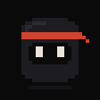
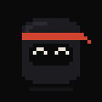
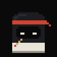
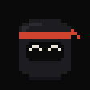
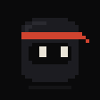
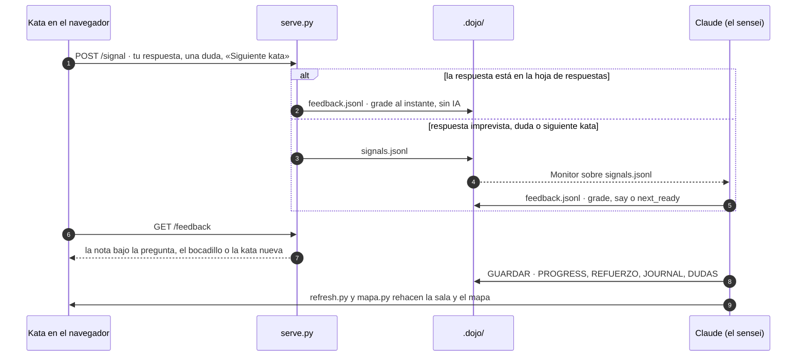

<div align="center">


# Sensei Dojo

**Un tutor persistente para Claude Code. Aprendes tú; la IA no hace el trabajo por ti.**

Katas de 15-20 minutos en una presentación oscura con un sensei en pixel art,<br>
preguntas con una sola respuesta, tareas en tu herramienta real y un árbol de habilidades que se acuerda de ti.

[](#instalación)
[](https://github.com/Lozadaa/skillsmith)
[](skills/dojo/scripts)
[](#cómo-funciona)
[](LICENSE)

[Qué es](#qué-es) · [Instalación](#instalación) · [Cómo funciona](#cómo-funciona) · [Capturas](#capturas) · [Pruébalo](#pruébalo-sin-instalar-nada) · [English](#in-english)

</div>

---

<p align="center">
  
  
</p>

## Qué es

Escribe `/dojo` en cualquier carpeta. El sensei detecta qué hay (un `package.json`, un `pyproject.toml`, una base de datos, un proyecto de motor…) o te pregunta qué quieres aprender, te hace un diagnóstico corto y **construye el curriculum de ese dominio**: siete cinturones, de blanco a negro, cada concepto con sus prerrequisitos, su tarea y sus preguntas.

A partir de ahí, cada `/dojo` es una kata: un concepto, una presentación HTML que se abre sola, una tarea que haces tú en la herramienta de verdad y tres preguntas que se corrigen en la misma página. Todo queda en `.dojo/`, en Markdown que puedes leer y editar, para retomarlo semanas después donde lo dejaste.

> **La regla del dojo:** el sensei no escribe tu código. Si le dictas, teclea; si le pides «hazlo tú», te da una pista.

## Lo que lo hace distinto

| Qué | Cómo |
|---|---|
| 🥋 **Katas de 15-20 min** | Un concepto por kata, como mucho 8 slides: Recuerda → Dónde estamos → La idea → Lado a lado → Predice → **Haz** → **Demuestra** → Cierre. |
| 🎯 **Preguntas deterministas** | Solo preguntas con una respuesta comprobable: un comando, una tecla, un texto que aparece en pantalla. Nunca «¿qué te pareció?». |
| 🌐 **La kata se dirige desde la web** | Respondes, pides ayuda y pasas a la siguiente kata desde la página. `serve.py` lleva cada botón a `signals.jsonl` y el sensei contesta en `feedback.jsonl`; el chat queda como respaldo. |
| ⚡ **Hoja de respuestas local** | Cada kata trae su `NNN-slug.key.json` con las variantes previstas (correcta, parcial, trampa). `serve.py` corrige al instante lo previsto y solo lo raro llega a la IA. |
| 🧠 **Repaso espaciado y lagunas** | Lo dominado vuelve a los 3, 7, 21 y 60 días. Lo que no supiste va a `REFUERZO.md` con tu frase literal y vuelve como tarjeta «Recuerda» hasta acertarlo dos días distintos. |
| 💬 **«Tengo una duda»** | Un panel en cada slide (tecla <kbd>?</kbd>). Cada duda se registra en `DUDAS.md` y **decide la kata siguiente**: si un concepto acumula dudas, se profundiza antes de avanzar. |
| 🗺️ **El mapa** | El curriculum como árbol de habilidades con tu estado, el camino hasta tu meta y tres frases de *por qué estás aquí*. Lo genera `mapa.py` en cada guardado. |
| 🪜 **Escalera de pistas** | Dónde mirar → qué buscar → casi la respuesta → la respuesta. Nunca salta al último peldaño. |
| 🔇 **Adaptación silenciosa** | Sube o baja la dificultad por lo que observa, sin preguntarte si quieres algo más difícil. Si estás cansado, cierra con una victoria. |
| 🧩 **Cualquier dominio** | Git, SQL, Python, JavaScript, Blender, un motor de juego, un instrumento… El curriculum se construye en la primera sesión. |

## El Sensei

Un ninja de 24 × 24 píxeles, dibujado en un `<canvas>` con escala entera de píxel (nunca borroso). Mira hacia donde mueves el ratón, parpadea, te sigue a la caja donde escribes y cambia de pose según lo que pasa en la kata.

<table align="center">
  <tr>
    <td align="center"><br><sub><b>normal</b><br>mira y parpadea</sub></td>
    <td align="center"><br><sub><b>happy</b><br>acertaste</sub></td>
    <td align="center"><br><sub><b>write</b><br>corrige con pincel</sub></td>
    <td align="center"><br><sub><b>bow</b><br>te saluda</sub></td>
    <td align="center"><br><sub><b>point</b><br>señala lo que toca</sub></td>
  </tr>
</table>

Los GIF salen del dibujo real: [`docs/sensei_gif.py`](docs/sensei_gif.py) ejecuta la función `draw()` de [`assets/plantilla.html`](skills/dojo/assets/plantilla.html) en Chromium headless, fotograma a fotograma.

## Instalación

**Como skill** (lo más directo, se invoca con `/dojo`):

```bash
git clone https://github.com/Lozadaa/sensei-dojo.git
cp -r sensei-dojo/skills/dojo ~/.claude/skills/dojo
```

En Windows (PowerShell): `Copy-Item -Recurse sensei-dojo\skills\dojo $HOME\.claude\skills\dojo`.

**Como plugin** de Claude Code (se invoca con `/sensei-dojo:dojo`):

```text
/plugin marketplace add Lozadaa/sensei-dojo
/plugin install sensei-dojo@sensei-dojo
```

Requisitos: Python 3.9+ (solo biblioteca estándar) y un navegador. Nada más.

## Uso

| Comando | Qué hace |
|---|---|
| `/dojo` | La primera vez, ceremonia de entrada: diagnóstico y curriculum. Después, la siguiente kata según tu progreso. |
| `/dojo estado` | Seis líneas: cinturón, dominados, repasos pendientes, lagunas, racha y siguiente kata. |
| `/dojo repaso` | Solo el repaso espaciado de hoy, sin concepto nuevo. |
| `/dojo explica <tema>` | Mini-lección de 3 slides que no cuenta como kata. |
| `/dojo salto <concepto>` | ¿Crees que ya lo dominas? Pruébalo con sus preguntas. |
| `/dojo cansado` | Cierra ahora con una victoria y guarda. |

También se activa sin el comando: «enséñame…», «quiero aprender…», «quiz me», o abrir Claude Code en una carpeta que ya tiene `.dojo/`.

## Cómo funciona



Una kata pasa por cinco momentos:

1. **Mostrar.** El sensei lee tu estado, elige el modo (avanzar, repasar, reparar o reingreso), construye la presentación desde la plantilla, escribe su hoja de respuestas y deja construida la siguiente.
2. **Hacer.** La tarea en tu herramienta, como mucho 7 pasos. Si te atascas, el Sensei de la página tiene los tres primeros peldaños de pistas.
3. **Demostrar.** Tres preguntas, una cada vez, corregidas bajo cada pregunta con 0, 1 o 2 puntos y una frase que dice por qué.
4. **Cerrar.** Siempre con una victoria concreta y un gancho para la próxima.
5. **Guardar.** `PROGRESS.md`, `REFUERZO.md`, `JOURNAL.md` y `DUDAS.md` antes de despedirse; `refresh.py` regenera la sala y el mapa. «Siguiente kata» navega sola a la nueva.

### Lo que queda en tu proyecto

```text
.dojo/
├── DOJO.md          dominio, meta a 3 meses, perfil del aprendiz, reglas acordadas
├── curriculum.md    siete cinturones con prerrequisitos, tareas y preguntas con respuesta
├── PROGRESS.md      cada concepto: estado, puntaje y próximo repaso
├── JOURNAL.md       diario append-only con tus respuestas literales
├── REFUERZO.md      lagunas abiertas: lo que el dojo te debe
├── DUDAS.md         lo que preguntaste, y qué hará el dojo con ello
├── signals.jsonl    lo que manda la página
├── feedback.jsonl   lo que contesta el sensei
└── lessons/         index.html (la sala) · mapa.html · NNN-slug.html + .key.json
```

## Capturas

Todas salen del dojo de demostración de este repo ([`demo/.dojo`](demo/.dojo), un aprendiz de Git en cinturón amarillo) con [`docs/shots.py`](docs/shots.py).

<table>
  <tr>
    <td width="50%"><br><sub><b>La sala.</b> El saludo, la frase de por qué toca lo que toca y todas tus katas.</sub></td>
    <td width="50%"><br><sub><b>Haz.</b> Un mapa de qué toca en cada paso, los pasos a la izquierda y el código a la derecha.</sub></td>
  </tr>
  <tr>
    <td width="50%"><br><sub><b>Corrigiendo.</b> El Sensei escribe con pincel mientras llega la nota.</sub></td>
    <td width="50%"><br><sub><b>Tengo una duda.</b> Pregunta sin salir de la kata; la duda dirige las siguientes.</sub></td>
  </tr>
</table>

<p align="center"><br><sub><b>El mapa.</b> Tu curriculum como árbol: lo dominado, dónde estás, el camino a tu meta y lo que el dojo te debe.</sub></p>

## Pruébalo sin instalar nada

El repo trae un dojo de demostración. Sírvelo y ábrelo:

```bash
python skills/dojo/scripts/serve.py demo/.dojo/lessons --port 8766
```

Después, `http://localhost:8766/`. Las respuestas previstas en la hoja de respuestas se corrigen solas; para el resto haría falta el sensei.

## Diseño

- **Oscuro y tipográfico.** Una rejilla con canal y eje, serif para títulos, un único acento bermellón para lo de hoy.
- **Una pregunta por vez.** Demuestra y Recuerda enseñan una pregunta, la corrigen y pasan a la siguiente.
- **Sin dependencias.** Plantillas HTML autocontenidas y scripts en Python estándar. Las cajas de código colorean `py`, `js`, `sql`, `sh`, `cs`, `cpp` e `ini` sin librerías.
- **Nada de paredes de texto.** Máximo 6 líneas por mensaje en el chat; lo largo va a la presentación, con diagramas.

## Estructura del repo

```text
sensei-dojo/
├── skills/dojo/              el skill (esto es lo que se instala)
│   ├── SKILL.md              reglas del sensei, ciclo de la kata, archivos del dojo
│   ├── references/           pedagogía, estado, lección, cómo construir un curriculum
│   ├── assets/               plantilla.html (kata) · index.html (sala) · mapa.html
│   ├── scripts/              serve.py · refresh.py · mapa.py (stdlib)
│   └── evals/                casos de prueba del skill
├── demo/.dojo/               dojo de demostración (Git)
├── docs/                     GIF, capturas y los scripts que los generan
└── .claude-plugin/           manifiesto de plugin y marketplace
```

## Calidad

Pulido en bucle con [skillsmith](https://github.com/Lozadaa/skillsmith) hasta **99/100**. El único hallazgo que queda es una sugerencia, rechazada a propósito: renombrar `dojo` a un gerundio rompería `/dojo`. Cada ronda pasó también por:

```bash
npx @lozadaa/skillsmith --path skills/dojo --report
python skills/dojo/scripts/mapa.py --selfcheck
python skills/dojo/scripts/serve.py --selfcheck
python skills/dojo/scripts/refresh.py demo/.dojo/lessons
```

Para regenerar el GIF y las capturas: `python docs/sensei_gif.py` y `python docs/shots.py` (necesitan Playwright con Chromium y Pillow).

---

## In English

**Sensei Dojo** is a Claude Code skill that turns Claude into a persistent tutor for *any* technical tool or discipline (Git, SQL, Python, a game engine, Blender…). It teaches in 15-20 minute **katas**, each one a dark, self-contained HTML deck guided by a pixel-art sensei:

- **You do the work.** The sensei never writes your code unless you dictate it; it gives hints on a four-step ladder instead.
- **Deterministic checks.** Every quiz question has one verifiable answer (a command, a key, an on-screen string), graded 0/1/2 right on the page.
- **Web-first loop.** A tiny stdlib server (`serve.py`) carries answers and doubts from the page to `.dojo/signals.jsonl`. Claude replies through `feedback.jsonl`, and a per-kata answer key grades the expected variants instantly, offline.
- **It remembers you.** Progress, spaced repetition (3/7/21/60 days), knowledge gaps quoted in your own words, and your doubts all live in plain Markdown under `.dojo/`. Doubts steer the next kata.
- **Skill tree.** `mapa.py` renders your curriculum as a prerequisite tree with your current concept, the path to your 3-month goal, and *why you're here*.

Install it with `cp -r skills/dojo ~/.claude/skills/dojo` and type `/dojo`, or add it as a plugin with `/plugin marketplace add Lozadaa/sensei-dojo`. The UI and docs are in Spanish; the sensei speaks your language.

## Licencia

[MIT](LICENSE) © Richard A. Lozada
